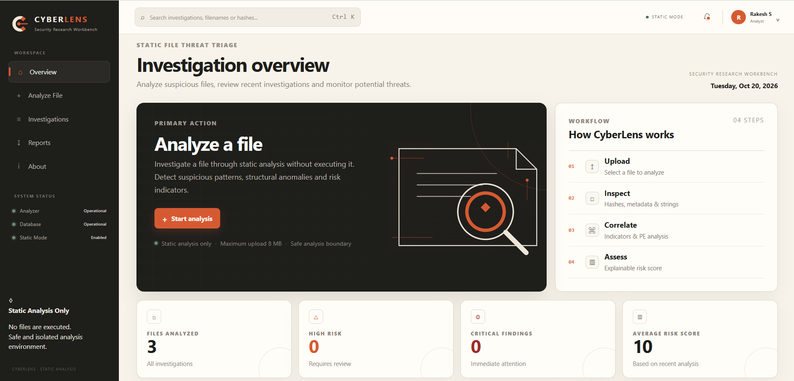
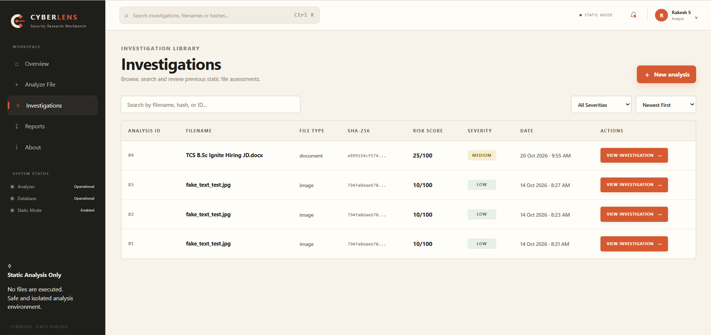
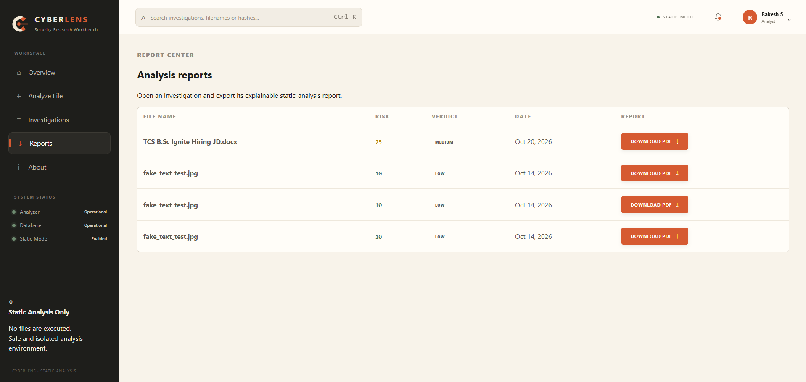

# CyberLens

**Static File Threat Triage & Malware Analysis Workbench**

> *See the file. Understand the risk.*

---

## Overview

CyberLens is a defensive static analysis platform designed to help security analysts investigate files by examining their static characteristics and presenting evidence-based security indicators.

CyberLens performs analysis **without executing uploaded files**. It combines file identification, cryptographic hashing, metadata inspection, string extraction, entropy analysis, PE analysis, indicator detection, and explainable risk scoring into a single investigation workflow.

---

## Important Disclaimer

CyberLens is designed for **preliminary security triage** and educational analysis.

Analysis results represent static indicators and should **not** be treated as definitive malware classification. Suspicious files should always be investigated in an isolated and controlled environment.

CyberLens does not execute uploaded files.

---

## Key Features

- Secure file upload and validation
- Static analysis without file execution
- File type and MIME identification
- MD5, SHA-1 and SHA-256 hashing
- File metadata analysis
- String extraction and categorization
- Entropy analysis
- PE file analysis
- Suspicious indicator detection
- Explainable risk scoring
- Analyst verdicts and recommendations
- Investigation history
- Search and filtering
- PDF investigation reports
- Responsive security-focused interface
- LAN-accessible analysis interface

---

## Analysis Workflow

```text
File Upload
     ↓
File Identification
     ↓
Cryptographic Hashing
     ↓
Metadata Analysis
     ↓
String Extraction
     ↓
Entropy Analysis
     ↓
PE Analysis
     ↓
Indicator Detection
     ↓
Risk Scoring
     ↓
Analyst Verdict
     ↓
Investigation Report
```

---

## 📸 Screenshots

### Dashboard

The CyberLens dashboard provides an overview of recent investigations, risk distribution, system status, and analysis activity.



---

### File Analysis

The file analysis interface allows analysts to select a file for static analysis. Uploaded files are inspected without execution.


---

### Investigation Library

The Investigation Library provides a searchable history of previous investigations, including analysis IDs, filenames, file types, SHA-256 hashes, risk scores, severity, timestamps, and investigation actions.



---

### Analysis Result

The analysis result page presents the investigation verdict, file identity, file type, MIME type, file size, entropy, risk score, and detailed static-analysis findings.


---

### Reports

The Report Center provides access to generated investigation reports and allows analysts to export analysis results as PDF documents.



---

## 🔍 Analysis Capabilities

### File Identification

CyberLens identifies the uploaded file using:

- File extension
- MIME type
- File size
- File category
- PE signature detection
- Executable classification
- Double-extension detection
- Extension/MIME consistency checks

### Cryptographic Hashing

CyberLens calculates:

- MD5
- SHA-1
- SHA-256

These hashes provide unique cryptographic fingerprints that can be used for investigation and correlation.

### Metadata Analysis

The platform extracts available file metadata such as:

- Access time
- Modification time
- Creation time
- Filesystem size
- Format
- MIME type
- Image dimensions
- Color mode
- Type consistency

### String Extraction

CyberLens extracts readable strings from files and categorizes potentially useful content such as:

- URLs
- IP addresses
- Email addresses
- File paths
- Registry paths
- Commands
- Suspicious keywords

### Entropy Analysis

Entropy analysis is used to identify unusually random or packed-looking data.

Higher entropy can indicate:

- Compression
- Encryption
- Packing
- Obfuscation

Entropy is treated as an indicator rather than definitive proof of malicious activity.

### PE Analysis

For supported Windows PE files, CyberLens can inspect structural characteristics without executing the file.

Analysis may include:

- PE headers
- Sections
- Imports
- Entry point
- Characteristics
- Section entropy
- Suspicious structural properties

### Indicator Detection

CyberLens uses predefined security indicators to identify suspicious static characteristics.

Each indicator provides evidence that contributes to the overall risk assessment.

### Explainable Risk Scoring

CyberLens calculates a transparent risk score based on detected indicators.

| Score | Severity | Interpretation |
|---:|---|---|
| 0–24 | LOW | Likely Safe |
| 25–49 | MEDIUM | Suspicious |
| 50–74 | HIGH | High Risk |
| 75–100 | CRITICAL | Critical Risk |

The score is intended for **triage and prioritization**, not definitive malware classification.

---

## 🛡️ Security Design

CyberLens follows a static-analysis-first security model.

### Static Analysis Only

Uploaded files are inspected but never executed.

### Controlled Uploads

Uploads are protected using:

- Maximum upload size
- Allowed file extensions
- MIME validation
- Safe file handling
- Randomized storage names
- Path traversal protection

### File Validation

CyberLens compares file extensions and detected MIME types to identify potential inconsistencies.

### Safe Processing

The analysis pipeline does not use uploaded files as executable commands.

CyberLens avoids:

- `os.system()`
- `subprocess`
- `shell=True`
- `exec()`
- `eval()`

for processing uploaded files.

### No Network-Based Execution

Uploaded files are not sent to external services or executed through network-based mechanisms.

---

## 🧰 Technology Stack

### Backend

- Python 3.11
- Flask
- Flask-SQLAlchemy
- SQLAlchemy
- SQLite

### Static Analysis

- `hashlib`
- `pathlib`
- `os`
- `re`
- `math`
- `python-magic`
- `pefile`

### Frontend

- HTML5
- CSS3
- JavaScript
- Responsive UI

### Reporting

- ReportLab

### Testing

- pytest

---

## 📁 Project Structure

```text
CyberLens/
│
├── analyzer/
│   ├── __init__.py
│   ├── hashing.py
│   ├── file_identification.py
│   ├── metadata.py
│   ├── strings.py
│   ├── entropy.py
│   ├── pe_analyzer.py
│   ├── indicators.py
│   ├── risk_engine.py
│   └── file_utils.py
│
├── database/
│   ├── __init__.py
│   └── models.py
│
├── routes/
│   ├── __init__.py
│   ├── analysis.py
│   └── history.py
│
├── reports/
│   ├── __init__.py
│   └── report_generator.py
│
├── templates/
│   ├── base.html
│   ├── dashboard.html
│   ├── analyze.html
│   ├── result.html
│   ├── history.html
│   ├── reports.html
│   └── about.html
│
├── static/
│   ├── css/
│   │   └── style.css
│   ├── js/
│   │   ├── dashboard.js
│   │   ├── analyze.js
│   │   └── result.js
│   └── assets/
│
├── sample_data/
│   ├── sample_normal.txt
│   ├── sample_suspicious.txt
│   └── fake_image.jpg
│
├── tests/
│   ├── test_hashing.py
│   ├── test_entropy.py
│   ├── test_indicators.py
│   ├── test_risk_engine.py
│   └── test_file_security.py
│
├── uploads/
├── instance/
│
├── app.py
├── config.py
├── requirements.txt
├── .env.example
├── .gitignore
├── LICENSE
└── README.md
```

---

## ⚙️ Installation

### 1. Clone the repository

```bash
git clone https://github.com/YOUR-USERNAME/CyberLens.git
cd CyberLens
```

Replace `YOUR-USERNAME` with your GitHub username.

---

### 2. Create a virtual environment

Windows:

```powershell
python -m venv venv
```

Activate it:

```powershell
.\venv\Scripts\Activate.ps1
```

---

### 3. Install dependencies

```powershell
pip install -r requirements.txt
```

---

### 4. Configure environment variables

Create a `.env` file in the project root.

Example:

```env
SECRET_KEY=replace-with-a-random-secret-key
MAX_UPLOAD_SIZE=8388608
```

Do not commit the `.env` file to GitHub.

The repository includes `.env.example` as a template.

---

## ▶️ Running CyberLens

Start the Flask application:

```powershell
python app.py
```

The application runs locally at:

```text
http://127.0.0.1:5000
```

For LAN access, use:

```text
http://YOUR-LAN-IP:5000
```

Example:

```text
http://192.168.1.36:5000
```

---

## 🔌 API Endpoints

CyberLens provides API endpoints for analysis and investigation management.

### Upload and Analyze

```text
POST /api/upload
```

Uploads a file and starts the static-analysis workflow.

### Investigation History

```text
GET /api/history
```

Returns previous investigations.

### Investigation Result

```text
GET /result/<analysis_id>
```

Displays the analysis result for a specific investigation.

### PDF Report

```text
GET /api/report/<analysis_id>
```

Generates and downloads the investigation report as a PDF.

---

## 🧪 Testing

CyberLens includes automated tests covering core analysis and security functionality.

Run the complete test suite:

```powershell
python -m pytest tests -v
```

Expected result:

```text
16 passed
```

Tests cover areas including:

- File hashing
- Entropy calculation
- Indicator detection
- Risk scoring
- File security
- Analysis functionality

---

## 📊 Investigation Management

CyberLens stores investigation records in SQLite.

Each investigation contains information such as:

- Investigation ID
- Filename
- SHA-256
- MD5
- SHA-1
- File type
- MIME type
- File size
- Entropy
- Risk score
- Severity
- Detected indicators
- Analysis data
- Investigation timestamp

The same file can be analyzed multiple times, creating a separate investigation record for each analysis.

---

## 📄 PDF Reports

CyberLens can generate PDF reports containing explainable analysis results.

Reports can include:

- File information
- Cryptographic hashes
- Metadata
- Entropy information
- Detected indicators
- Risk score
- Severity
- Analyst verdict
- Security recommendations

---

## 🎨 Design Philosophy

CyberLens is designed as a professional security research workbench rather than a traditional malware-scanning interface.

The interface uses:

- Warm parchment workspace
- Charcoal navigation
- Burnt-orange action elements
- Restrained borders and shadows
- Enterprise-style typography
- Monospace formatting for hashes and indicators
- Clear evidence-to-risk presentation

The goal is to keep the interface focused on **evidence, investigation, and analyst decision-making**.

---

## ⚠️ Limitations

CyberLens is a static-analysis platform and therefore has limitations.

It does not:

- Execute uploaded files
- Perform dynamic malware behavior analysis
- Replace a sandbox
- Guarantee malware detection
- Provide definitive malware classification
- Replace professional incident-response procedures
- Automatically determine whether a file is completely safe

Static indicators should always be interpreted in context.

---

## 🔮 Future Improvements

Potential future improvements include:

- YARA rule integration
- VirusTotal hash lookup
- Advanced document analysis
- Office macro analysis
- Archive inspection
- Improved PE import analysis
- IOC export
- JSON investigation reports
- User authentication and role-based access
- Investigation tagging
- Advanced search
- Analyst notes
- Timeline-based investigation views
- Threat intelligence integration
- Docker deployment
- Automated CI/CD security testing

---

## 📌 Project Status

**CyberLens is an actively developed defensive cybersecurity project.**

Current implementation includes:

- Secure file upload
- Static file analysis
- Cryptographic hashing
- File identification
- Metadata analysis
- String extraction
- Entropy analysis
- PE analysis
- Indicator detection
- Explainable risk scoring
- Investigation history
- Dashboard statistics
- PDF report generation
- Security-focused interface
- Automated testing
- LAN deployment support

---

## 👨‍💻 Author

**Rakesh S**

BCA Graduate  
MCA — Cybersecurity Specialization

Interested in:

- Cybersecurity
- Security Operations
- Malware Analysis
- Network Security
- Threat Detection
- Security Automation

---

## ⚖️ Disclaimer

CyberLens is intended for **educational, defensive security research, and preliminary file triage purposes**.

Only analyze files that you are authorized to inspect.

The author is not responsible for misuse of the software or for decisions made solely based on its analysis results.

---

## ⭐ Project Goal

> **See the file. Understand the risk.**

CyberLens aims to make static file investigation more transparent, explainable, and accessible to security learners and analysts.